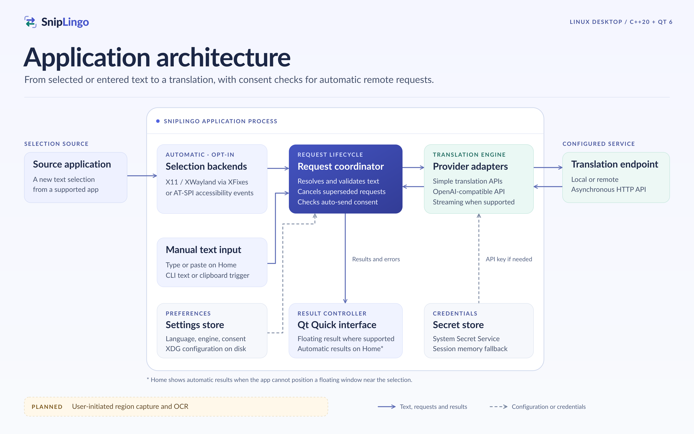

# Architecture

- `src/app/` assembles the application, CLI, window and backend lifecycles.
- `src/selection/` defines how a backend reports a selection. `src/platform/` implements AT-SPI
  accessibility events and X11 primary selection, including XWayland where supported. A session uses
  one selection backend.
- `src/coordinator/` handles manual and selection requests, checks consent before automatic remote
  sending, and cancels superseded work so an older reply cannot replace a newer result.
- `src/provider/` translates through the configured service. `src/settings/` stores preferences
  and the consent record. `src/secrets/` handles credentials through the desktop keyring or
  session-only storage when persistent storage is unavailable.
- `src/ui/` presents the main window, floating result and tray menu using Qt and QML.

Use [the contribution guide](../CONTRIBUTING.md) to build and test changes, and [the Linux guide](linux-integration.md)
to diagnose desktop-specific behavior.
